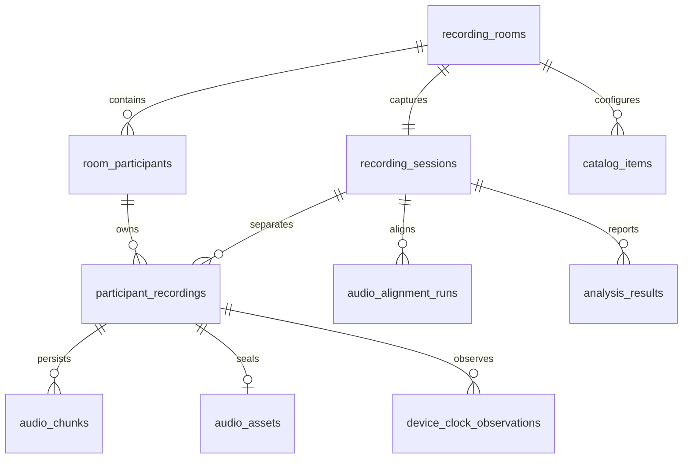

# 系統與 PostgreSQL 設計

## 模組

`App.tsx` 保留模板的畫面結構；`useRoom.ts` 管理連線與權威狀態；`capture.ts` 封裝麥克風、MediaRecorder、補傳；`storage.ts` 封裝 IndexedDB 原子寫入。

FastAPI `app.py` 負責房間認證及狀態轉換，`audio.py` 處理分段與封存，`catalog.py` 提供設定及分析讀取，`models.py` 驗證加工欄位。HTTP/WebSocket 是整合測試 seam；PostgreSQL 使用真實交易，沒有以記憶體 mock 替代正式儲存。

## 保留 V1.2 的決定

V1.2 的 `public.recording_sessions`、`recording_channels`、`audio_chunks` 有單一設備、共同採樣時鐘與交錯 PCM 契約。直接把手機壓縮片段塞進原表會破壞既有分析資料。

因此使用 additive `mobile_capture` schema，既有 28 表完全保留；手機使用自己的 Session 和 participant recordings，沒有假造 capture_device 或三通道 frame。舊錄音與新手機錄音目前並列；跨 schema 實驗／麥克風主檔映射與原分析管線整合仍待後續遷移設計，不自動猜測既有資料對應。

## 表與不變條件

| 表 | 關係／內容 |
|---|---|
| recording_rooms | UUID、六位安全隨機英數代碼（排除 O/0/I/1）、建立／到期／關閉時間 |
| room_participants | room FK、A/B/C 唯一位置、姓名、token_hash、host/mic/ready、錯誤 |
| recording_sessions | 每房間一次 Session，狀態、條件快照、伺服器開始／停止時間 |
| participant_recordings | session + participant 複合 PK；同一 room 的複合 FK 防跨房間音訊混淆；獨立 participant_recording_id UUID、MIME、取樣率／聲道、手機與伺服器起訖、單調時鐘時長、per-machine 狀態 |
| audio_chunks | 複合 FK 至個別錄音；participant_recording_id、source_label、連續 index、bytes／byte_size、SHA256、client/server 時間 |
| audio_assets | 封存 manifest，總 chunk/bytes/SHA256；原始 bytes 保存在 chunks 並按序串流重建 |
| device_clock_observations | 每裝置 client send / server receive / client receive / monotonic performance 時間 |
| audio_alignment_runs | 對齊 method、status、offsets、evidence；尚無自動對齊工作程序 |
| analysis_results | 真實分析 JSON 與建立時間；尚無 DSP／模型計算工作程序 |
| catalog_items | room+kind+name 唯一；機台／材料／刀具／裝夾／加工範本，目前保存完整加工快照 |

## 加工欄位對照

欄位保存在 `recording_sessions.conditions` JSONB；API 透過 `Conditions` 強型別模型拒絕缺漏、非有限值、負數及未知欄位。開始後 API 鎖定快照。SQL JSONB 可查詢，例如 `conditions->>'machine_code'`，數值例如 `(conditions->>'spindle_rpm')::numeric`。

| 領域 | JSONB keys |
|---|---|
| CNC 機台 | machine_code, machine_name, machine_model |
| 工件材料／工件 | material, material_spec, workpiece_code |
| 刀具／裝夾 | tool_type, tool_material, tool_diameter_mm, tool_flutes, tool_overhang_mm, tool_setup |
| 加工參數 | spindle_rpm, feed_mm_min, axial_depth_mm, radial_width_mm, process, coolant, toolpath, nc_program |

不把正常、異常、磨耗當作錄音前條件。刀具直徑 >0 且 ≤1000 mm；刃數 1–100；其他數值 0–1,000,000。最終實際採樣率及手機音訊處理行為由裝置／瀏覽器決定；不宣稱校正後 SPL 或固定 PCM 格式。

## 執行限制

目前是單一控制程序設計，適合此三手機工作流程。PostgreSQL advisory lock 排除第二個程序，避免多 worker 各自保有不同 WebSocket 名單。生產環境若要水平擴充，需要共享訊息代理與租約，不可直接增加 workers。

所有修改都以 PostgreSQL 交易執行；狀態轉換與分段封存鎖定 Session，避免開始／停止／重複上傳競爭。重新連線不會自動授權麥克風或假設已就緒。房間代碼可加入空的 B/C 位置，持 token 才能操作已佔用的聲源。
