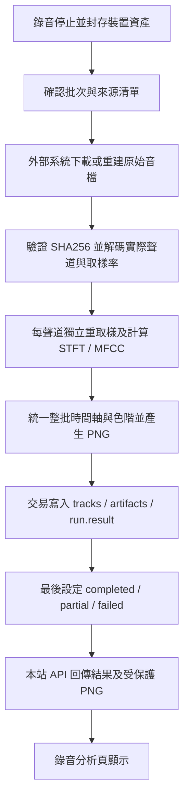

# CNC Acoustic Lab｜外部音訊分析系統對接規格

文件日期：2026-11-17  
對象：外部分析系統開發人員、後端工程師、資料庫管理人員  
依據：目前 CNC Acoustic Lab 原始碼及 mobile_capture Schema。本文僅說明接口，不代表已完成外部系統整合。

## 1. 對接範圍與重要結論

外部系統負責讀取每台裝置的真實錄音，獨立計算每個聲道的 **時頻圖（Spectrogram）** 與 **梅爾頻率倒譜係數圖（MFCC）**，再交回分析狀態、來源資訊及 PNG 圖片，供 CNC Acoustic Lab 顯示。

MFCC 不是 Mel Spectrogram；本頁第二區塊使用 C0～C19 的 MFCC 係數熱圖。

現況：

- 已有原始音檔下載 API、分析狀態查詢 API、分析 PNG 讀取 API。
- 已有 PostgreSQL 工作、音軌與圖檔資料表，可作為共同資料庫對接基礎。
- **尚無供外部系統上傳分析結果／PNG 的 HTTP API，也沒有外部工作領取、callback 或服務帳號接口。**
- 現有 `POST .../analysis` 是要求內建分析程序執行，不是上傳外部結果。
- 內建分析 worker 目前會自動領取 queued 工作。因此外部系統不能直接加入同一工作佇列就宣稱完成接管；正式對接前須決定工作歸屬及重啟恢復策略。

兩種整合方式：

| 方式 | 音檔取得 | 結果回傳 | 適用與現有限制 |
|---|---|---|---|
| 共用 PostgreSQL | 讀取資產與分段表，或搭配既有下載 API | 寫入音軌、分析工作與圖檔表 | 現有資料結構可承接，但需協調 worker、資料庫權限與交易契約 |
| HTTP API | 使用既有原始音檔 API | 另行設計結果提交 API | 適合獨立服務；目前只有讀取及啟動分析，缺少外部結果寫入 API |

若希望外部系統完全負責計算、本站只顯示結果，建議以 **HTTP 服務邊界** 作為正式整合方向；若先以共同資料庫實作，必須遵守下列資料表與結果契約。這是整合建議，並非目前已可直接切換的設定。

## 2. 需要交付給協作人員的連線資訊

| 項目 | 目前本機資訊／應提供內容 |
|---|---|
| 資料庫類型 | PostgreSQL |
| 資料庫名稱 | `cnc_acoustic_lab` |
| 本機 port | `5432` |
| 錄音與分析 Schema | `mobile_capture` |
| 本機後端 | `http://127.0.0.1:8000` |
| 原始碼介面文件 | 後端運行時的 `/docs` 與 `/openapi.json` |
| 遠端服務位址 | 由部署負責人提供可達的主機／HTTPS 網址，不能把 localhost 當成遠端位址 |
| 認證 | 資料庫使用專用角色；HTTP 現有 API 使用房間 Bearer token |

本文件不提供密碼、token 或完整含密碼連線字串。正式整合時另以安全管道提供憑證。不要把現有 PostgreSQL 管理者帳號當作外部分析服務帳號。

目前後端有網路來源限制，預設監聽 loopback；位於另一台主機的服務不能直接連到這個 localhost。網路路由、反向代理、允許來源及服務認證需由部署負責人另外配置。資料庫角色權限不會自動套用 HTTP 的房間權限。

## 3. 核心識別鍵

| 名稱 | 意義與對應 |
|---|---|
| `session_id` | 一次錄音批次，對應 `mobile_capture.recording_sessions.id` |
| `room_id`／`room_code` | 房間識別；room_code 用於現有音檔下載 API |
| `participant_id` | 此房間的錄音參與者，亦是原始資產的裝置識別 |
| `device_id` | 新分析音軌表使用的名稱；目前值等於 `participant_id`，不是 `public.capture_devices` 的 ID |
| `channel_index` | 裝置音檔內的 0-based 聲道索引：Mono=0、Left=0、Right=1 |
| `track_id` | 每一條實際聲道的 UUID |
| `run_id` | 一次分析執行的 UUID，對應 `track_analysis_runs.id` |

原始音檔資產沒有獨立的單欄 UUID 主鍵；使用 **`(session_id, participant_id)` 複合鍵**。結果 JSON 的 `audio_asset_id` 是 `session_id/device_id` 字串表示，不是資料庫額外欄位。

目前 track_id 生成方式為 Python：

```python
uuid5(NAMESPACE_URL, f'cnc:{session_id}:{participant_id}:{channel_index}')
```

外部系統若寫回同一資料庫，應沿用該生成規則，或先查詢既有 `(session_id, device_id, channel_index)` 的 track_id，避免同一音軌建立不同 ID。

## 4. 外部分析系統需要讀取的資料表

以下表名全部應使用完整 Schema，避免讀到 `public` 下同名的舊版表。

| 資料表 | 讀取用途 | 重要欄位 |
|---|---|---|
| `mobile_capture.recording_sessions` | 批次狀態、加工條件、錄音時間 | `id`, `room_id`, `status`, `created_at`, `conditions`, `machine_id`, `started_at`, `stopped_at` |
| `mobile_capture.recording_rooms` | 找出 room_code，供下載 API 使用 | `id`, `code` |
| `mobile_capture.participant_recordings` | 每台裝置的錄音與封存狀態 | `session_id`, `participant_id`, `source_position`, `status`, `interrupted`, `sample_rate`, `channel_count`, `requested_sample_rate`, `requested_channel_count`, `duration_ms`, `expected_chunks` |
| `mobile_capture.room_participants` | 取得顯示名稱 | `id`, `name`；不需要讀取 `token_hash` |
| `mobile_capture.audio_assets` | 確認已封存音檔及完整性資訊 | `session_id`, `participant_id`, `mime_type`, `chunk_count`, `byte_count`, `checksum` |
| `mobile_capture.audio_chunks` | 原始音檔分段位元組 | `session_id`, `participant_id`, `chunk_index`, `audio_data`, `checksum` |

`audio_assets` 保存索引與驗證資訊，**不保存可直接打開的檔案路徑**。實際編碼音訊位元組在 `audio_chunks.audio_data`（bytea）。

歷史來源排序應用 `participant_recordings.source_position`，不要用參與者目前的 `source_label`；後者可能因退出而變成 NULL。

### 4.1 來源清單查詢範例

以下為 psycopg 參數化 SQL；`%s` 由程式綁定 session_id，不以字串拼接使用者輸入。

```sql
SELECT s.id AS session_id, s.status AS session_status,
       s.created_at, s.conditions, r.code AS room_code,
       pr.participant_id, pr.source_position,
       p.name AS device_name, pr.status AS recording_status,
       pr.interrupted, pr.requested_sample_rate,
       pr.requested_channel_count,
       pr.sample_rate AS reported_sample_rate,
       pr.channel_count AS reported_channel_count,
       pr.duration_ms, pr.expected_chunks,
       a.mime_type, a.chunk_count, a.byte_count, a.checksum
FROM mobile_capture.recording_sessions s
JOIN mobile_capture.recording_rooms r ON r.id = s.room_id
JOIN mobile_capture.participant_recordings pr ON pr.session_id = s.id
JOIN mobile_capture.room_participants p ON p.id = pr.participant_id
LEFT JOIN mobile_capture.audio_assets a
  ON a.session_id = pr.session_id AND a.participant_id = pr.participant_id
WHERE s.id = %s
ORDER BY pr.source_position, pr.participant_id;
```

LEFT JOIN 可保留尚未封存或缺失的裝置，讓分析系統回報缺失而非悄悄省略。

### 4.2 從資料庫重建原始檔

```sql
SELECT chunk_index, audio_data, checksum
FROM mobile_capture.audio_chunks
WHERE session_id = %s AND participant_id = %s
ORDER BY chunk_index;
```

依序串接原始 bytes，確認分段數、索引連續、總 byte_count，以及整檔 SHA-256 等於 audio_assets.checksum。使用串流／暫存檔避免把大型原始檔全部拼在記憶體。

分段是 WebM／MP4／Ogg 等原始容器的片段，不能假設每個 chunk 都可獨立解碼，也不能把每段的 channel_count 當作 Session 總音軌數。以重建後解碼出的取樣率、聲道數、frames 為準。

封存存在不等同錄音未中斷：還需檢查 `participant_recordings.interrupted` 與 status。允許分析中斷錄音時應保留其不完整性標示。現有排程允許 finalizing／completed／interrupted 且至少一個資產已封存；整批完整分析宜等待所有預期資產封存。

## 5. 可直接使用的既有 HTTP API

### 5.1 下載某裝置的原始錄音

```http
GET /api/rooms/{room_code}/recordings/{participant_id}/audio?take_id={session_id}
Authorization: Bearer <該房間有效 token>
```

回應：音檔二進位串流、Content-Type、Content-Length、X-Checksum（整檔 SHA-256）。尚未封存回傳 409。房間有效成員可下載同房間錄音，不限該檔擁有者。

此 API 已依 chunk_index 串接原始分段，外部系統不必自行讀 audio_chunks。下載後仍要解碼確認真正格式；檔名與回報 metadata 不取代解碼資訊。

### 5.2 查詢分析結果

```http
GET /api/v1/sessions/{session_id}/analysis?start_seconds=0
Authorization: Bearer <該房間有效 token>
```

整段分析省略 end_seconds；指定區間例如 `start_seconds=10&end_seconds=20`。回傳此 Session、相同時間條件下最新建立工作的 status 與 result。它不是「按 run_id 查詢」接口；回傳內容中的 run_id 表示實際取得的工作。

### 5.3 啟動現有內建分析

```http
POST /api/v1/sessions/{session_id}/analysis
Authorization: Bearer <該房間主控 token>
Content-Type: application/json

{"start_seconds": 0, "end_seconds": null}
```

回傳 HTTP 202 與 run_id。**這不是外部結果上傳 API**，會將工作交給目前內建 worker。

### 5.4 讀取分析 PNG

```http
GET /api/v1/sessions/{session_id}/analysis/{run_id}/tracks/{track_id}/spectrogram.png
GET /api/v1/sessions/{session_id}/analysis/{run_id}/tracks/{track_id}/mfcc.png
Authorization: Bearer <該房間有效 token>
```

後端根據 run_id、track_id、kind 讀取資料庫 PNG bytes。必須確實寫入 artifact，不是只拼一個 URL。不存在的圖回傳 404。

目前沒有矩陣下載 HTTP API。矩陣若需交付外部研究系統，需另約定受權限保護的讀取接口。

## 6. 外部結果要寫回哪裡

要讓目前的分析頁直接顯示外部結果，共同資料庫方案涉及 **三張表加上一份 JSON 契約**。

### 6.1 `mobile_capture.recording_tracks`：實際聲道資料

| 欄位 | 型別／規則 |
|---|---|
| `track_id` | UUID 主鍵，跨分析工作保持穩定 |
| `session_id` | 批次 UUID |
| `device_id` | 原始音檔 participant_id UUID |
| `device_name` | 顯示名稱 text |
| `channel_index` | integer，0 或 1 |
| `channel_label` | Mono／Left／Right |
| `source_channel_count` | integer，實際解碼 1 或 2 |
| `requested_sample_rate` | integer，可 NULL；歷史未知不要猜值 |
| `original_sample_rate` | integer > 0，實際解碼原始 rate |
| `actual_sample_rate` | integer > 0，實際解碼 rate |
| `analysis_sample_rate` | integer，目前資料庫約束固定 44100 |
| `duration_seconds` | double precision > 0，原始音檔實際時長 |
| `total_frames` | bigint > 0，原始每聲道 sample frame 數 |
| `analysis_status` | completed／failed／no_data |

唯一鍵 `(session_id, device_id, channel_index)`；複合外鍵 `(session_id, device_id)` 指向 audio_assets。Mono 只能 index=0；Stereo index=0 是 Left、index=1 是 Right。不能將 Mono 複製成兩軌。

本表的 analysis_status 是音軌摘要；不同時間區間的工作狀態應讀各自 run 的 result，而非把此欄當作完整歷史。

### 6.2 `mobile_capture.track_analysis_runs`：工作及前端結果

| 欄位 | 型別／規則 |
|---|---|
| `id` | UUID，即 run_id |
| `session_id` | UUID，外鍵至 recording_sessions |
| `fingerprint` | text，與 session_id 組成唯一鍵，用於去重 |
| `start_seconds` | double precision >= 0 |
| `end_seconds` | NULL 或大於 start_seconds；NULL 代表整段直到有效結尾 |
| `status` | queued／running／completed／partial／failed |
| `result` | JSONB；前端實際使用的來源與圖表資料 |
| `created_at` | timestamptz，預設 now()；目前查詢按此選取最新工作 |

前端顯示的 `not_started` 是查無工作時由 API 組成，**不是此表允許寫入的 status**。

**只寫 recording_tracks 或圖檔表還不夠：目前 API 直接讀取 track_analysis_runs.result。外部系統必須同步寫入 result.tracks 與圖表 URL，前端才看得到。**

fingerprint 不是來源檔 checksum。正式外部契約應由來源 checksum、區間、算法名稱／版本與參數決定；現有內建函式使用自己的 Python 序列化及版本字串計算 fingerprint，尚未定義跨語言標準。不要在不同算法之間共用 fingerprint、覆寫同一工作冒充相同結果。

### 6.3 `mobile_capture.track_analysis_artifacts`：PNG／矩陣內容

| 欄位 | 型別／規則 |
|---|---|
| `run_id` | UUID，外鍵至 track_analysis_runs |
| `track_id` | UUID，外鍵至 recording_tracks |
| `kind` | spectrogram／mfcc／matrices |
| `content` | bytea，實際檔案 bytes |

主鍵 `(run_id, track_id, kind)`。spectrogram、mfcc 必須是 PNG 二進位；不是 Base64 字串、檔案路徑或外部 URL。PNG 必須包含時間軸、頻率／係數軸及共用色階圖例，因為目前前端直接顯示成品圖。

內建 matrices 格式是 `np.savez_compressed` NPZ，包含：

- `spectrogram`：shape `(1025, T)` 的數值矩陣。
- `mfcc`：shape `(20, T)` 的數值矩陣。
- `times`：shape `(T,)` 的時間秒數。
- `valid_range`：長度 2 的有效窗涵蓋範圍。

目前前端不讀 matrices；若要維持研究可重現性，外部系統仍應保存數值結果並協議此格式。不要使用 kind=matrices 存入未標明格式的任意檔案。

### 6.4 result JSON 範例

以下為結構示例，不是真實分析結果；UUID、數值、參數與版本由實際工作產生，不能固定沿用。

```json
{
  "session_id": "11111111-1111-4111-8111-111111111111",
  "run_id": "22222222-2222-4222-8222-222222222222",
  "status": "completed",
  "analysis_sample_rate": 44100,
  "completed_device_count": 1,
  "analyzable_track_count": 1,
  "duration_seconds": 10.0,
  "time_range": [0.0, 10.0],
  "mfcc_color_range": [-900.0, 100.0],
  "parameters": {
    "analysis_sample_rate": 44100,
    "fft_size": 2048,
    "hop_length": 441,
    "window": "periodic Hann",
    "mel_bands": 64,
    "mfcc_count": 20,
    "dct": "II orthonormal",
    "algorithm_version": "external-system-version"
  },
  "versions": {"analysis_service": "actual-version"},
  "source_errors": [],
  "tracks": [
    {
      "track_id": "33333333-3333-4333-8333-333333333333",
      "session_id": "11111111-1111-4111-8111-111111111111",
      "device_id": "44444444-4444-4444-8444-444444444444",
      "device_name": "錄音者 A",
      "channel_index": 0,
      "channel_label": "Mono",
      "source_channel_count": 1,
      "requested_sample_rate": 48000,
      "reported_sample_rate": 48000,
      "original_sample_rate": 48000,
      "actual_sample_rate": 48000,
      "analysis_sample_rate": 44100,
      "duration_seconds": 10.0,
      "total_frames": 480000,
      "audio_asset_id": "11111111-1111-4111-8111-111111111111/44444444-4444-4444-8444-444444444444",
      "source_checksum": "實際原始檔 SHA-256",
      "analysis_status": "completed",
      "spectrogram_url": "/api/v1/sessions/11111111-1111-4111-8111-111111111111/analysis/22222222-2222-4222-8222-222222222222/tracks/33333333-3333-4333-8333-333333333333/spectrogram.png",
      "mfcc_url": "/api/v1/sessions/11111111-1111-4111-8111-111111111111/analysis/22222222-2222-4222-8222-222222222222/tracks/33333333-3333-4333-8333-333333333333/mfcc.png"
    }
  ]
}
```

實際結果還應保存 valid_range、完整振幅參考／重取樣／Mel 定義等參數。API 會另外從 Session 加入 session_name、created_at、recording_status。

有些來源失敗時，將失敗裝置寫入 `source_errors`（device_id、device_name、status、error）；成功聲道保留。已解碼但沒有足夠區間資料的音軌可用 no_data、附 error，圖表 URL 為 null。部分成功時工作 status=partial；全部失敗時 failed。不要讓缺失來源產生假的 Right 或空白偽造圖。

## 7. 對接流程及交易要求



1. 原始 assets／chunks 為輸入，不因分析改寫或刪除。
2. 每個 run 只允許一個有效執行者領取；資料庫方案可沿用短交易內 `FOR UPDATE SKIP LOCKED` 領取，但這只避免同時領取，不能解決跨系統重啟時的工作歸屬問題。
3. 解碼與繪圖在領取交易提交後執行，不長時間占用工作列鎖。
4. 寫回順序為 run 已存在 → tracks 已存在 → artifacts → result JSON → 最終 status。成功圖與其 URL、參數應在同一完成交易內可見。
5. result 內的 session_id、track_id 必須與所引用的資料列一致；目前 artifacts 的兩個外鍵不會單獨保證 track 與 run 同 Session，外部寫入者必須驗證。
6. 同一 run 重試使用相同鍵，避免重複 artifact；新的算法／區間應是新 run。
7. 補傳或較晚封存的裝置會改變來源集合，需再安排完整分析；不要將先前 partial 結果當成整批最終結果。

### 7.1 必須先協調的 worker 問題

目前內建 worker 自動讀取全部 queued 工作，且本站重啟會將全部 running 改回 queued，沒有 producer／owner／lease 欄位，也沒有停用內建分析的既有公開設定。

因此，**不能讓外部系統和目前內建 worker 無協調地共同操作相同工作**。即使使用 SKIP LOCKED，本站重啟仍可能讓外部正在執行的工作被重領。正式接管須由雙方決定以下其中一項並另行實作／配置：

- 本站不再執行內建分析，由外部系統獨占分析工作。
- 區分工作類型與擁有者，加入租約／重試規則。
- 外部系統使用獨立工作管線，只透過結果提交 API 發布完成品。

本文件沒有替專案實作上述切換；現有系統仍由內建 worker 工作。

## 8. 分析參數契約

若外部系統要與目前頁面及既有結果直接比較，使用下列設定：

| 項目 | 現行規格 |
|---|---|
| 分析取樣率 | 44100 Hz |
| 原始取樣率 | 實際解碼為準，支援 44100／48000 Hz |
| 聲道 | 實際 Mono／Stereo 各自分析 |
| STFT | FFT=2048，hop=441，periodic Hann |
| 窗策略 | center=False，只處理完整窗，不用假的訊號補足尾端 |
| 頻率範圍 | 0～22050 Hz |
| 振幅尺度 | FFT 絕對振幅除 Hann 總和；單邊非 DC／Nyquist 頻點乘二 |
| Spectrogram 色階 | 20 log10(max(amplitude, 1e-6))；固定 -120～0 dBFS，peak amplitude 1 為完整刻度，非校正聲壓 |
| Mel filters | 64，HTK 頻率轉換，三角濾波器 unit peak |
| MFCC | 振幅平方→Mel→10 log10(max(power,1e-12))→DCT-II orthonormal→C0～C19 |
| MFCC 色階 | 同一 run 所有成功音軌共用 min/max，不逐張正規化 |
| 時間軸 | 各錄音起點為 0 秒；同一 run 共用顯示區間；不宣稱樣本級同步 |

48000→44100 必須實際抗混疊重取樣。現行實作是 147/160 polyphase，FIR 長度 `128*max(up,down)+1`、Kaiser beta 8.6、截止 `1/max(up,down)`。其他正確算法可以另外約定，但須記錄不同版本，不宣稱與現行數值完全相同。

不足完整窗、不同時長、超出有效資料範圍應據實顯示；軸與數字最多兩位小數僅影響顯示，不影響矩陣精度。

目前 PNG 沒有前端動態換算色階或頻率軸；外部產生的圖若使用不同定義，必須同步協議前端文字與資料契約，不可只換圖片卻沿用不符的標示。

## 9. 加工條件是否需要一起提供

純 STFT／MFCC 計算不需要加工條件，但可為研究追溯一併提供：

- **`mobile_capture.recording_sessions.conditions`**：該次錄音的加工條件快照，為主要依據。
- `recording_sessions.machine_id`：機台識別。
- `public.machines`：需要補充目前機台主檔時才讀取。

不要用現時的 `public.machining_presets` 範本取代歷史錄音的 conditions；範本可能在錄音後被編輯。

## 10. 權限與資料責任

共同資料庫模式建議僅提供：

- 輸入資料表必要欄位的 SELECT；room_participants 不需 token_hash。
- recording_tracks、track_analysis_runs、track_analysis_artifacts 所需的 SELECT／INSERT／UPDATE。
- 不授予原始錄音表 UPDATE／DELETE，不授予 DDL 或資料庫管理權限。

外部服務若只能處理部分房間，需另設範圍限制（例如受控 view／服務 API）；直接授權整表 SELECT 不等於沿用本站房間隔離。結果 PNG 不應直接公開成可猜測的外部網址。現有前端會附房間 Bearer 取得圖片，因此沿用本站相對 API URL 最容易維持現有權限邊界。

HTTP 模式的房間 token 會因退出或撤銷而失效，不適合作為未經設計的長期服務憑證；正式外部系統認證需要另行約定。

## 11. 協作驗收清單

- [ ] 明確選擇資料庫寫回或新增 HTTP 結果提交方案。
- [ ] 明確決定內建／外部 worker 的工作歸屬、重啟與重試方式。
- [ ] 使用真正的封存音檔，驗證 byte_count／SHA256。
- [ ] 三台 Mono 得到 3＋3 張；1/2/1 得到 4＋4 張；三台 Stereo 得到 6＋6 張。
- [ ] Left／Right 使用不同訊號驗證，沒有複製或平均後偽裝。
- [ ] 混合 44100／48000、回報 metadata 不符時以實際解碼資訊為準。
- [ ] 同一批次所有圖的時間軸、頻率範圍與各類色階一致。
- [ ] 真正計算 MFCC，不交付 Mel Spectrogram 替代品。
- [ ] run.result、tracks、artifacts、URL 全部對應正確。
- [ ] 相同 run 重送結果不重複；不同算法／參數不誤用同一 fingerprint。
- [ ] 部分失敗仍保留其他成功聲道；缺失來源有明確狀態。
- [ ] 本站查詢 API 能讀到結果，PNG API 可下載且拒絕無權限使用者。
- [ ] 重新整理、Session／區間切換、手機版顯示正常。
- [ ] 不修改原始音檔、錄音紀錄與加工條件。

## 12. 原始碼與 Schema 對照

| 檔案 | 內容 |
|---|---|
| `backend/migrations/001_mobile_capture.sql` | 原始錄音房間、分段、資產等基礎表 |
| `backend/migrations/003_recording_metadata.sql` | 原始錄音 metadata／chunk identity |
| `backend/migrations/004_multi_recorder.sql` | 歷史來源位置與多裝置擴充 |
| `backend/migrations/005_track_analysis.sql` | 音軌、分析工作、PNG／矩陣資料表 |
| `backend/audio.py` | 原始錄音串流下載與封存排程 |
| `backend/analysis.py` | 現行 worker、結果 JSON、查詢與 PNG API |
| `backend/analysis_signal.py` | 現行 STFT／MFCC 定義與輸出格式 |
| `frontend/src/RecordingAnalysis.tsx` | 前端實際消費的欄位與圖片讀取方式 |

`mobile_capture.analysis_results` 是舊分析 JSON 儲存表，`public.analysis_runs`／`public.analysis_artifacts` 屬舊 V1.2 模型。**目前新的 Spectrogram／MFCC 頁面使用的是 track_analysis_runs／track_analysis_artifacts；不要把外部結果寫入舊表後期待新頁面自動讀取。**
